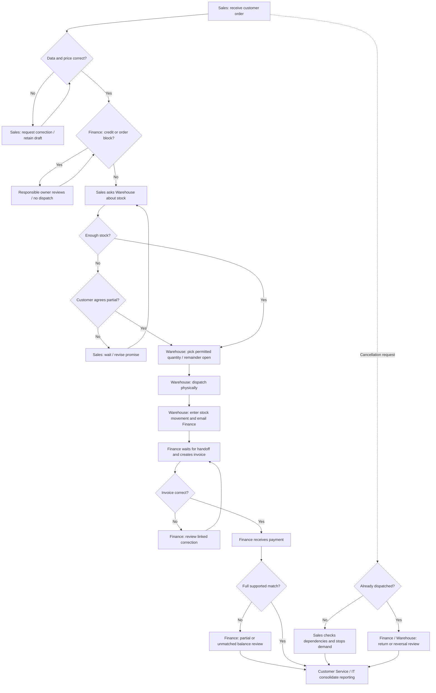

# AS-IS process and root-cause hypotheses

Independent simulated portfolio · 2026-10-11 · AI-assisted draft; learner review pending.

This is a **process flowchart, not BPMN**. Tools and responsibilities are fictional current-state assumptions. Shared owner labels show uncertain handoffs that the TO-BE must resolve.

The full eight-step register is in as-is-step-register.csv. Cancellation after dispatch is an exception routed to controlled review, not a full returns redesign. Unmatched and partial payments remain visible rather than pretending the order is financially complete.

## Five Whys — late billing hypothesis
1. Why is billing late? A dispatched delivery is absent from the billing review list.
2. Why absent? Finance has not received or located the handoff email.
3. Why does that matter? The email is treated as the trigger instead of reconciling all eligible deliveries.
4. Why is reconciliation absent? Ownership of the complete billable population is unclear.
5. Why unclear? The cross-team procedure defines individual tasks but no accountable handoff outcome.

This chain is a hypothesis, not a root cause proven by five repetitions. Alternative explanations include pricing incompleteness, goods-issue timing, invoice schedules or accounting blocks. Compare dispatch, posting, invoice and output dates plus exception reasons before attributing delay. A missing receipt timestamp can be an evidence gap rather than a late physical delivery.

## Root-cause test plan
| Hypothesis | Evidence that supports it | Evidence that could refute it | Proposed response |
|---|---|---|---|
| Fragmented status causes enquiries | Enquiry timestamps coincide with inconsistent team records | Accurate shared records exist but users cannot locate them | Shared definitions or usability training depending on evidence |
| Promise ignores commitments | Orders promised beyond usable stock at confirmation | Stock was sufficient but damaged during picking | Availability review or warehouse control depending on cause |
| Email handoff delays billing | Eligible items wait until email arrives | Items were blocked for pricing despite timely email | Queue ownership or pricing correction depending on cause |
