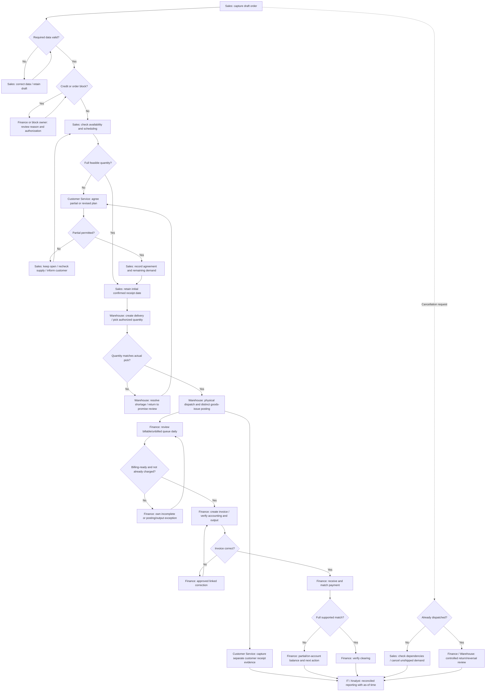

# SAP reference and proposed TO-BE

Independent simulated portfolio · 2026-10-11 · AI-assisted draft; learner review pending.

## Reference boundary
Select SAP S/4HANA Cloud Public Edition **2602**, using the official release-specific feature scope document version 5.0 dated 11 June 2026. This is a stable research reference, not a claim to use the newest release or a live tenant. Public Edition suits a standard-first learning exercise; it is not free SAP hosting. Learning pages support concepts but are not pinned to 2602. Feature entitlement, country scope, activation and exact configuration require validation.

## Essential concepts
A business partner is the common customer identity with role-specific information (SAP-005). A sales order records the requested commercial transaction. Availability and scheduling help establish a feasible quantity/date; shelf stock alone is insufficient (SAP-002). An outbound delivery organizes shipping; partial-delivery rules need agreement (SAP-003). Goods issue records the outbound stock event, while physical dispatch and receipt are separately evidenced. Billing charges the customer and connects to receivables, the amount owed (SAP-001). Finance then handles payment matching and differences (SAP-006). No step has been demonstrated in an SAP system.

## Proposed process flowchart — not BPMN

## Ownership, controls and handoffs
Sales owns valid order/promise information; Customer Service records agreement and communication; Warehouse owns quantities and dispatch/posting evidence; Finance owns credit, billable-population reconciliation, corrections and allocation; IT supports roles, interfaces and reporting. A handoff is complete when the receiving role has a linked, actionable record or a named exception—not simply an email. RULE-001 through RULE-012 apply. PC-001 through PC-015 identify changes in traceability.csv.

The base NS-ORD-1001 remains unresolved: 100 ordered at £25, 60 physically on hand, requested receipt 9 October. A **separate design variant** assumes 60 are usable and the customer agrees: deliver/bill 60 (£1,500 net), keep 40 open; a £900 partial payment leaves £600 analytical exposure on that invoice. This is an illustration, not an executed order or the baseline record's actual history.

## Current vs proposed
| Current assumption | Proposed change | Why / alternative |
|---|---|---|
| Fragmented status lists | Linked order view with reason and owner | Standard views first; controlled shared register if fit unresolved |
| Shelf-stock promise | Availability/scheduling review and retained original promise | Manual checked promise can be an interim control |
| Informal split approval | Explicit permission, quantity and remainder | Complete delivery when customer does not agree |
| Dispatch-email billing trigger | Finance queue and daily reconciliation | Daily manual checklist is a credible low-cost option |
| Ad hoc payment matching | Supported allocation and visible unmatched queue | Keep on-account investigation; no forced write-off |

## Data needs beyond the analytical dataset
Customer identity/status and ship-to; product/UOM; quantity and price conditions; requested/initial confirmed dates; check time and block reasons; delivery references and authorized/actual quantities; dispatch/PGI/receipt timestamps; invoice/accounting/output status; corrections; receipt/allocation amounts; actor and change reason. The synthetic dataset is a deliberately smaller analytical model, not an SAP extraction schema or migration mapping.

Receipt capture may need a manual evidence field or carrier integration; this exact fit is unresolved. Returns/reversals, tax settings, replenishment, bank formats and retention policy are dependencies. Do not propose an extension until standard capture and export are tested. Official URLs and actual access date appear in sap-evidence.csv; two inaccessible Help pages are explicitly unverified.
